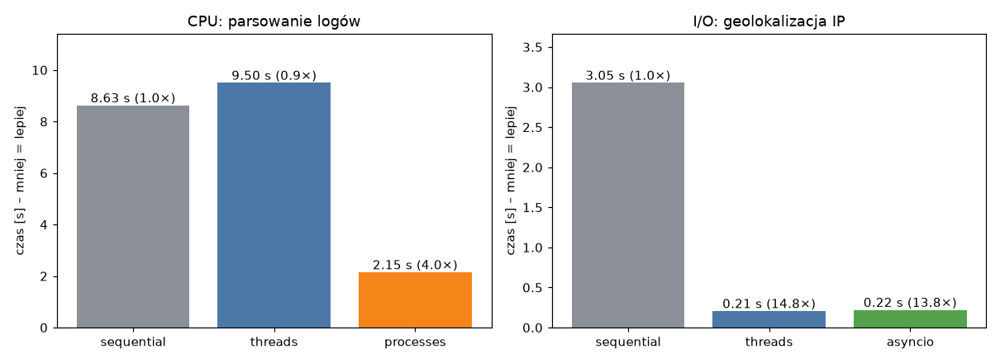

# Analizator logów serwera WWW

Projekt zaliczeniowy z przedmiotu *Zaawansowane techniki programowania w języku Python*.

Program wczytuje logi serwera WWW w formacie *Combined Log Format* (Apache/Nginx),
parsuje je wyrażeniami regularnymi i liczy statystyki. Wynik to:
- kody odpowiedzi i ich klasy (2xx–5xx),
- najaktywniejsze adresy IP i najpopularniejsze URL-e,
- URL-e z błędami 4xx/5xx,
- najbardziej obciążona godzina.

Pliki można analizować sekwencyjnie, w puli wątków albo w puli procesów.
Najaktywniejsze adresy IP są geolokalizowane współbieżnie w wątkach.
Wbudowany benchmark porównuje te tryby i pokazuje wpływ GIL.

Pliki są czytane blokami i przetwarzane potokiem generatorów, więc zużycie pamięci
nie zależy od rozmiaru pliku.

## Instalacja i uruchomienie

Wymagany jest Python 3.12+. Sam analizator korzysta tylko z biblioteki standardowej.
`pytest` służy do testów, a `matplotlib` do wykresu z benchmarku.

```bash
python -m venv .venv
.venv\Scripts\activate
pip install -r requirements.txt
```

Przykładowe polecenia:

```bash
python -m log_analyzer generate                    # 8 plików × 100 000 linii w data/logs/
python -m log_analyzer analyze data/logs           # analiza w puli procesów
python -m log_analyzer analyze data/sample.log --mode threads --top 5 --resolve-ips
python -m log_analyzer analyze data/logs --status 5 --url-regex "^/api" -v
python -m log_analyzer benchmark                   # wyniki w results/
pytest                                             # 59 testów
```

Opcje polecenia `analyze`:

| Opcja | Znaczenie |
|---|---|
| `--mode {sequential,threads,processes}` | tryb przetwarzania plików |
| `--workers N` | liczba wątków lub procesów |
| `--top N` | długość rankingów |
| `--status 404` / `--status 4` | dokładny kod HTTP albo cała klasa (4 = 4xx) |
| `--url-regex WZORZEC` | filtr URL-i wyrażeniem regularnym |
| `--resolve-ips` | geolokalizacja najaktywniejszych IP |
| `-v` | logi z czasami wykonania |

> W Git Bash wzorzec zaczynający się od `/` jest zamieniany na ścieżkę Windows.
> W takim przypadku użyj PowerShella albo ustaw `MSYS_NO_PATHCONV=1`.

## Struktura

```
log_analyzer/
  exceptions.py  hierarchia własnych wyjątków
  patterns.py    wyrażenia regularne (ekstrakcja i walidacja)
  models.py      LogEntry – jeden wpis logu
  reader.py      ChunkReader (iterator) + potok generatorów
  decorators.py  timer, retry(...)
  stats.py       FileStats, analyze_file (zadanie CPU-bound)
  analyzer.py    LogAnalyzer – tryby sequential / threads / processes
  geoip.py       IpDatabase, IpResolver – wątki + Lock + retry (zadanie I/O-bound)
  datagen.py     generator danych testowych
  report.py      raport tekstowy
  benchmark.py   pomiar porównawczy + wykres
  cli.py         argparse + logging
  __main__.py    punkt wejścia (python -m log_analyzer)
data/sample.log  mały log demonstracyjny (500 linii, w tym uszkodzone)
data/ip_db.csv   fikcyjna baza geolokalizacji IP
results/         wyniki benchmarku (tabela + wykres)
tests/           testy pytest
```

## Tabela mapowania zagadnień

| Zagadnienie | Gdzie w kodzie |
|---|---|
| Dekorator funkcji | `decorators.py` → `timer` (na `LogAnalyzer.analyze`) |
| Dekorator funkcji z parametrami | `decorators.py` → `retry(attempts, delay, exceptions)` (na `IpResolver._query_remote`) |
| `functools.wraps` | `timer`, `retry`, `requires_files` |
| Dekorator metody korzystający z `self` | `analyzer.py` → `requires_files` (sprawdza `self.paths`) |
| `@property` z setterem | `analyzer.py` → `LogAnalyzer.workers` |
| `@property` tylko do odczytu | `LogEntry.is_error`, `LogEntry.path`, `FileStats.error_rate` |
| `@classmethod` | `LogEntry.from_line`, `LogAnalyzer.from_directory`, `FileStats.combine`, `IpDatabase.load` |
| `@staticmethod` | `LogAnalyzer.default_workers` |
| Iterator (`__iter__`, `__next__`) | `reader.py` → `ChunkReader` |
| Generatory, `yield from` | `reader.py` → `read_lines` (`yield from`), `parse_lines`; `datagen.py` → `log_lines` (nieskończony) |
| Potok generatorów | `stats.py` → `analyze_file`: `read_lines → parse_lines → filter_entries` |
| Wyrażenia generujące | `reader.py` → `filter_entries`; `stats.py` → `error_rate`; `geoip.py` → `IpDatabase.lookup` |
| Regex z grupami nazwanymi | `patterns.py` → `LOG_LINE_RE`, `TIMESTAMP_RE` (ekstrakcja), `IPV4_RE` (walidacja), wzorzec z `--url-regex` |
| Wątki + synchronizacja | `geoip.py` → `IpResolver.resolve_threaded` (`ThreadPoolExecutor`) + `threading.Lock` |
| Procesy | `analyzer.py` → `LogAnalyzer.analyze("processes")` (`ProcessPoolExecutor`) |
| Pomiar GIL | `benchmark.py` → `cpu_benchmark`, `io_benchmark` |
| Obsługa błędów | `exceptions.py`; błędne linie zliczane w `ParseReport`; walidacja w `AnalyzerConfig.__post_init__` |
| Elementy dodatkowe | testy (`tests/`), CLI (`cli.py`, argparse), `logging`, wykres (`results/benchmark.png`) |

## Wyniki pomiarów

Polecenie: `python -m log_analyzer benchmark`.
- **Test CPU:** 8 plików × 100 000 linii (ok. 85 MB), 8 workerów, najlepszy z 3 przebiegów.
- **Test I/O:** geolokalizacja 150 adresów IP z opóźnieniem 20 ms na zapytanie, w 16 wątkach.

Środowisko: Python 3.12.10 (CPython) z włączonym GIL, 16 rdzeni logicznych, Windows 11.

| Scenariusz | Wariant | Czas [s] | Przyspieszenie |
|---|---|---:|---:|
| CPU: parsowanie logów | sequential | 8.713 | 1.00× |
| CPU: parsowanie logów | threads | 8.969 | 0.97× |
| CPU: parsowanie logów | processes | 1.711 | 5.09× |
| I/O: geolokalizacja IP | sequential | 3.049 | 1.00× |
| I/O: geolokalizacja IP | threads | 0.205 | 14.85× |



### Wnioski dotyczące GIL

<!-- TODO: 5–10 zdań własnymi słowami. Do omówienia:
     1. czym jest GIL,
     2. dlaczego wątki nie przyspieszyły parsowania (0.97×),
     3. dlaczego procesy przyspieszyły (5.09×) i czemu nie 8×,
     4. dlaczego wątki przyspieszyły geolokalizację (14.85×),
     5. wniosek: kiedy wątki, a kiedy procesy. -->

## Problemy napotkane w trakcie realizacji

- **`multiprocessing` na Windows.** Procesy startują metodą *spawn*: każdy proces importuje
  moduły od nowa, a funkcja i jej argumenty są przesyłane przez `pickle`. Wymusiło to kilka decyzji:
  - `analyze_file` jest funkcją na poziomie modułu,
  - konfiguracja jest przekazywana przez `functools.partial` (lambdy nie da się zserializować),
  - wzorzec URL jest przesyłany jako tekst i kompilowany w procesie roboczym,
  - `__main__.py` ma osłonę `if __name__ == "__main__"`.
- **Linie przecięte granicą bloku.** `ChunkReader` czyta stałe porcje bajtów, więc granica
  bloku może rozciąć linię, a nawet polski znak zapisany na 2 bajtach. Niepełny fragment
  trafia do bufora i jest sklejany z kolejnym blokiem. Dekodujemy dopiero całe linie.
  Test sprawdza bloki po 1, 3 i 7 bajtów.
- **Wyścig na liczniku.** `requests_made += 1` wywoływane z wielu wątków gubiłoby wartości,
  bo to nie jest operacja atomowa. Licznik i cache chroni `threading.Lock`.
  `time.sleep` (symulacja sieci) jest poza blokadą, bo inaczej wątki czekałyby na siebie nawzajem.
- **Niedeterministyczny test `retry`.** Kolejność wykonania wątków zmienia się między
  uruchomieniami. Test nie sprawdza więc konkretnych liczb, tylko niezmiennik:
  `zapytania = adresy + awarie − adresy nierozwiązane`.
- **Mutowalne wartości domyślne w dataclass.** Liczniki `Counter` w `FileStats` wymagają
  `field(default_factory=Counter)`. Zwykłe `= Counter()` współdzieliłoby jeden obiekt
  między wszystkimi instancjami.
